# video-to-gif

[](https://github.com/jbsaintebeuve/video-to-gif/actions/workflows/ci.yml)
[](https://github.com/jbsaintebeuve/video-to-gif/actions/workflows/security.yml)

Turn a video into a good-looking GIF, ready to paste (⌘V) or save. The video can be a local file or a link from X, YouTube, Instagram, TikTok and more.



## Install (macOS)

```sh
brew trust --formula jbsaintebeuve/tap/vid2gif
brew install jbsaintebeuve/tap/vid2gif
vid2gif setup
```

Since Homebrew 7, formulas from third-party taps must be trusted before they load. `brew trust --formula` trusts only this formula, not the whole tap. Homebrew also installs `ffmpeg` and `yt-dlp`. `vid2gif setup` then adds:

| Where | Quick Action | What it does |
|---|---|---|
| Finder: right-click a video → **Quick Actions** | **Convert to GIF** | Creates the GIF next to the video and copies it |
| Any app: right-click a selected link → **Services** | **Video Link to GIF** | Downloads the video and converts it |
| Anywhere: **⌃⌥⌘G** | **GIF from Copied Link** | Uses the link on your clipboard |

**For an X post:** choose *Share → Copy link*, then press ⌃⌥⌘G. A notification tells you when the GIF is ready. It is also saved in `~/Downloads`. Paste it with ⌘V.

You can change the shortcut in System Settings → Keyboard → Keyboard Shortcuts → Services. `vid2gif setup` never replaces a shortcut you set yourself.

- Update: `brew upgrade vid2gif`. The Quick Actions pick up the new version automatically.
- Uninstall: `vid2gif uninstall && brew uninstall vid2gif`.
- Log: `~/Library/Logs/vid2gif.log`.

## Linux and Windows

```sh
pipx install git+https://github.com/jbsaintebeuve/video-to-gif
```

You also need `ffmpeg` and `yt-dlp` (`apt install ffmpeg yt-dlp`, `winget install ffmpeg yt-dlp`). On Linux, copying to the clipboard needs `wl-clipboard` or `xclip`.

## Command line

```sh
vid2gif https://x.com/weirdnotwild/status/2114199180243857583 --copy
vid2gif clip.mov -w 360 -r 12 -s 1.5 -t 4      # 360 px wide, 12 fps, from 1.5 s to 5.5 s
vid2gif --clipboard --copy                     # copied link → copied GIF
```

| Option | Default | Effect |
|---|---|---|
| `-w, --width` | 480 | Maximum width. The video is never upscaled. |
| `-r, --fps` | 15 | Frames per second |
| `-s, --start` / `-t, --duration` | Whole video, 60 s max | Trims a clip |
| `--max-mb` | 15 | Shrinks the GIF automatically to stay under this size (`0` = no limit) |
| `-c, --copy` | Off | Copies the GIF to the clipboard |
| `-o, --outdir` | Next to the file / `~/Downloads` | Output folder |
| `--cookies-from-browser` | None | `chrome`, `safari`, `firefox`… for videos that require being logged in |

## Development

```sh
python3 -m venv .venv && .venv/bin/pip install pytest ruff
.venv/bin/pytest            # tests (integration tests need ffmpeg)
.venv/bin/ruff check . && .venv/bin/ruff format --check .
python3 -m vid2gif --help   # run from source
```

`node assets/demo/build.mjs` generates the animated demo (`assets/demo.svg`). Its text must match the output of `assets/demo/scenario.sh`, which runs the real vid2gif. CI fails if the SVG is stale.

CI (`.github/workflows/ci.yml`) runs lint and tests on macOS, Linux and Windows. It also installs the Homebrew formula from the commit's source, then checks `brew test`, `brew audit` and `vid2gif setup`. [SECURITY.md](SECURITY.md) describes the security checks.

### Releasing

1. Bump `__version__` in `vid2gif/__init__.py` and merge it into `main`.
2. `git tag v0.2.0 && git push origin v0.2.0`

The `release.yml` workflow reruns CI, creates the GitHub release and updates the formula in [jbsaintebeuve/homebrew-tap](https://github.com/jbsaintebeuve/homebrew-tap). It needs the `HOMEBREW_TAP_TOKEN` secret: a fine-grained token with read/write Contents access to the `homebrew-tap` repository only.

## How it works

`yt-dlp` downloads the video. `ffmpeg` then builds an optimized palette and converts the video to a looping GIF. If the GIF is larger than `--max-mb`, vid2gif tries again with a smaller width, then fewer frames per second and fewer colors.
